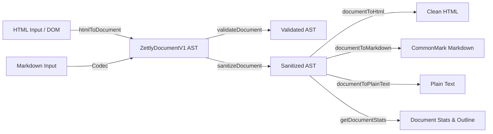

# Headless Document Engine

The headless document engine in `@programinglive/zettly-editor/core` provides pure Node.js AST validation, serialization codecs, sanitization, and document statistics without requiring any browser DOM globals or JSDOM runtime overhead.

## Architecture

## Available APIs

### AST Validation & Sanitization (`src/core/document-validator.ts`)

- `createEmptyDocument()`: Creates a canonical empty `ZettlyDocumentV1` document envelope.
- `isSafeUrl(url)`: Validates URLs against XSS schemes (`javascript:`, `data:`, `vbscript:`).
- `validateDocument(doc, options)`: Inspects nodes and marks, enforcing schema structure, permitted heading levels (1-6), safe link URLs, and optional permissions (`readOnly`, `allowLinks`, `allowImages`).
- `sanitizeDocument(doc)`: Strips unknown node/mark types and prototype pollution keys (`__proto__`, `constructor`), and neutralizes unsafe URLs.

### AST Codecs (`src/core/document-codec.ts`)

- `htmlToDocument(html)`: Parses HTML string into a `ZettlyDocumentV1` AST without DOM globals.
- `documentToHtml(doc)`: Serializes AST back into semantic HTML string.
- `documentToMarkdown(doc)`: Serializes AST into clean CommonMark Markdown.
- `documentToPlainText(doc)`: Serializes AST into plain text with paragraph delimiters.

### Document Analytics & Inspection (`src/core/document-stats.ts`)

- `getDocumentStats(input)`: Computes word count, character count, paragraph count, estimated reading time, link list, and image list.
- `inspectDocument(input)`: Generates detailed structural breakdown including document heading outline (TOC) and node counts.
